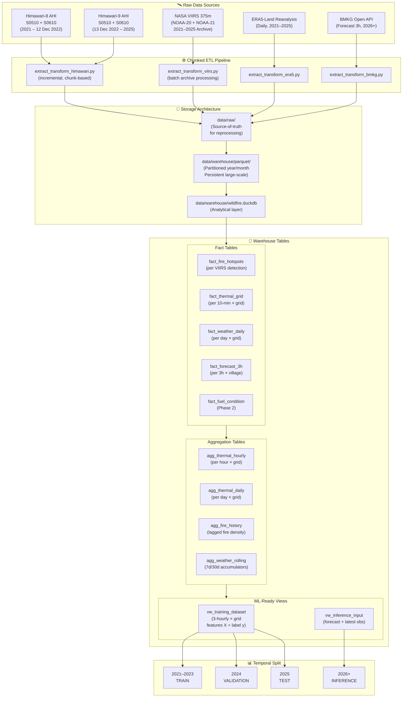

# Data Pipeline & Warehouse — Kalimantan Wildfire Risk Prediction

Membangun **data warehouse lokal** dan **ETL pipeline** yang mengintegrasikan multi-source satellite & weather data ke dalam satu sistem terpadu, siap digunakan oleh tim modeling untuk training dan inference.

---

## Konteks & Kondisi Saat Ini

Project sudah memiliki **pipeline akuisisi data** yang berjalan:
- ✅ Himawari-8/9 AHI → NetCDF (2km, 10-menit)
- ✅ NASA VIIRS 375m → CSV (hotspot aktif, 24h/7d sample)
- ✅ BMKG Open API → JSON/CSV (prakiraan cuaca 3-jam per desa)
- ✅ GEE ERA5-Land → CSV/JSON (reanalysis cuaca harian, sample)
- ✅ Prototype spatial join VIIRS↔Himawari via KD-Tree

**Yang belum ada:**
- ❌ Unified database / warehouse (data masih scattered CSV/JSON/NetCDF)
- ❌ Canonical spatial grid system
- ❌ Automated ETL pipeline dengan orchestration
- ❌ Historical data archive (VIIRS 2021–2025, Himawari 2021–2025, ERA5 2021–2025)
- ❌ Feature store yang ML-ready dengan anti-leakage safeguards
- ❌ Partitioned storage untuk multi-temporal data

---

## Keputusan Desain (Locked)

Berdasarkan review pipeline, kebutuhan modeling, dan kapasitas perangkat, berikut keputusan desain final:

| Item | Keputusan | Rationale |
|:---|:---|:---|
| **Historical Period** | **2021-01-01 → 2025-12-31** (5 tahun) | Menangkap variasi musim, kondisi iklim, dan kejadian kebakaran lintas tahun |
| **Training Split** | **2021–2023** = Train, **2024** = Validation, **2025** = Test | Temporal split untuk mencegah temporal leakage |
| **Inference Period** | **2026+** | Digunakan untuk operational/current-year monitoring |
| **Himawari Source** | **Himawari-8** (2021 – 12 Des 2022), **Himawari-9** (13 Des 2022 – 2025) | Mengikuti periode operasional masing-masing satellite |
| **Himawari Coverage** | **S0510 + S0610** | S0610 diperlukan untuk melengkapi coverage southern Kalimantan |
| **Himawari Storage Strategy** | **FULL 10-minute observations** | Mempertahankan temporal information lengkap untuk feature engineering dan eksperimen modeling |
| **Canonical Grid** | **0.02° (~2 km)** | Common modeling grid yang mendekati resolusi Himawari |
| **Raw Himawari Grain** | **1 row per grid × 10-minute observation** | Preservasi temporal resolution |
| **Thermal Feature Grain** | **Hourly + Daily aggregation** | Raw 10-minute data tetap tersedia; feature layer menyediakan agregasi bertingkat untuk ML |
| **ML Prediction Grain** | **3-hourly per grid cell** | Konsisten dengan BMKG forecast frequency dan memungkinkan sub-daily fire prediction |
| **Fire Prediction Horizon** | **Next 24 hours** | `fire_occurrence ∈ (T, T+24h]` |
| **Primary Target** | **`has_fire_24h`** | Binary fire occurrence prediction sebagai target utama |
| **Secondary Target** | **`fire_intensity_24h`** | `max(FRP)` untuk eksperimen regression tahap berikutnya |
| **Database Engine** | **DuckDB** | Embedded analytical database yang cocok untuk local data warehouse |
| **Storage Format** | **Partitioned Parquet** | Columnar, compressed, efficient untuk analytical workloads |
| **Partition Strategy** | **year/month** | Membatasi data scan ketika melakukan query berdasarkan periode |
| **Processing Strategy** | **Chunked / partition-based ETL** | Full dataset tidak dimuat sekaligus ke RAM |

> [!NOTE]
> **Scientific Note tentang Grid Resolution:**
>
> Canonical grid 0.02° (~2 km) digunakan sebagai common modeling grid. Ini bukan berarti seluruh sumber data memiliki resolusi native 2 km.
>
> - Himawari AHI memiliki resolusi spasial sekitar 2 km pada kanal yang digunakan.
> - ERA5-Land memiliki resolusi sekitar 0.1° (~9–11 km). Mapping ke grid 0.02° tidak menciptakan informasi spasial baru, hanya spatial alignment.
> - VIIRS memiliki resolusi sekitar 375 m dan di-aggregate ke canonical grid 0.02°, sehingga sub-pixel detail dapat hilang tetapi spatial alignment menjadi konsisten.
> - BMKG berbasis titik desa dan di-assign ke nearest canonical grid.
>
> Untuk Himawari, seluruh observasi 10-menit historis dipertahankan pada raw warehouse. Feature engineering dilakukan pada layer agregasi sehingga data raw tetap tersedia untuk eksperimen feature temporal.

---

## Local Processing Constraint

The pipeline is designed for a local Windows environment with limited RAM.

Therefore:

- Full historical Himawari data is retained on disk.
- ETL is chunk-based and incremental.
- Parquet is used as the primary analytical storage format.
- DuckDB queries operate directly against partitioned Parquet where possible.
- Large intermediate DataFrames must not be retained in memory.
- Raw source data and processed warehouse data are stored separately.

---

## Phase Scope

### Phase 1 — Core Pipeline (Scope Kali Ini)

| Source | Role | Status |
|:---|:---|:---|
| **NASA VIIRS 375m** | Target label (y) + lagged fire history feature | ✅ Phase 1 |
| **Himawari-8/9 AHI S0510 + S0610** | Thermal anomaly features (full Kalimantan coverage) | ✅ Phase 1 |
| **ECMWF ERA5-Land** | Historical weather backbone (temperature, humidity, rainfall, soil moisture, wind) | ✅ Phase 1 |
| **BMKG Open API** | Operational weather forecast input (T+24h → T+72h) untuk inference | ✅ Phase 1 |

### Himawari Coverage

Phase 1 menggunakan segment Himawari yang diperlukan untuk mencakup seluruh area Kalimantan:

- **S0510** → northern/equatorial portion (Lat ≥ 0°)
- **S0610** → southern portion (Lat < 0°)

Pipeline harus memproses kedua segment secara konsisten sebelum dilakukan spatial mapping ke canonical grid.

> [!IMPORTANT]
> Tanpa S0610, southern Kalimantan (Kalimantan Selatan, sebagian Kalimantan Tengah) tidak memiliki coverage Himawari yang lengkap sehingga tidak sesuai dengan tujuan project yang mencakup seluruh Kalimantan.

### VIIRS Historical Archive

Training menggunakan periode 2021–2025 sehingga pipeline membutuhkan VIIRS **historical archive**, bukan data active 24h/7d saja:

- NASA FIRMS menyediakan archive download untuk VIIRS 375m (NOAA-20 tersedia sejak 2018, NOAA-21 sejak Feb 2023)
- Data 24h/7d yang sudah ada di `data/viirs/raw/` hanya digunakan untuk validasi dan prototype, bukan sebagai sumber training historis

### Phase 2 — Enhancement (Future Scope)

| Source | Role | Status |
|:---|:---|:---|
| **MODIS MOD13A1** | NDVI, EVI (canopy greenness / fuel dryness) | 📋 Belum di-extract |
| **Sentinel-2 MSI** | NDMI (canopy water content) | 📋 Belum di-extract |
| **Sentinel-1 SAR** | VH/VV ratio (peat canopy structure, cloud-penetrating) | 📋 Belum di-extract |
| **ESA WorldCover** | Land cover classification refinement | 📋 Belum di-extract |
| **CHIRPS** | Higher-res gridded precipitation (0.05°) | 📋 Belum di-extract |

> [!IMPORTANT]
> Phase 1 pipeline harus bisa **berjalan end-to-end** tanpa menunggu data Phase 2. `fact_fuel_condition` table dibuat di schema tapi dikosongkan — diisi saat Phase 2.

---

## Himawari 10-Minute Storage Strategy

> [!IMPORTANT]
> Phase 1 menyimpan seluruh observasi Himawari 10-menit selama historical period 2021–2025.
>
> Dengan sekitar:
>
> - 144 observations/day (S0510 + S0610)
> - ~1,826 hari
> - ~140,000 land grid cells
>
> total logical grain dapat mencapai estimasi:
>
> `140,000 × 1,826 × 144 ≈ 36.8 billion rows`
>
> Data **tidak** diproses sekaligus di memory. ETL menggunakan:
>
> - chunk-based reading
> - incremental transformation
> - partitioned Parquet (year/month)
> - DuckDB analytical queries against Parquet
>
> sehingga peak memory usage tidak bergantung langsung pada total historical row count.
>
> Raw NetCDF dan processed Parquet dipisahkan sehingga raw source tetap dapat digunakan untuk reprocessing apabila diperlukan.

---

## Primary ML Target

`has_fire_24h` — Binary classification:

```text
1 → at least one VIIRS fire detection occurs in (T, T+24h]
0 → no VIIRS fire detection occurs in (T, T+24h]
```

### Secondary / Future Target

`fire_intensity_24h` — defined as `max(FRP)` during `(T, T+24h]`.

Target ini digunakan sebagai optional regression task setelah binary classification pipeline tervalidasi.

> [!IMPORTANT]
> Phase 1 focuses primarily on `has_fire_24h`. `fire_intensity_24h` is retained as a secondary target and should not block the core pipeline.

---

## Temporal Anti-Leakage Rules

Untuk setiap prediction timestamp `T`:

### Allowed

Semua feature harus tersedia pada atau sebelum `T`:

```text
X.timestamp ≤ T
```

### Forbidden

Tidak boleh menggunakan informasi yang baru tersedia setelah `T`:

```text
X.timestamp > T
```

### Target

Target menggunakan fire detections setelah waktu prediksi:

```text
T < fire_datetime ≤ T + 24h
```

### Fire History Features

Historical fire features harus strictly berada sebelum T:

```text
previous_24h = (T - 24h, T]
previous_7d  = (T - 7d, T]
```

Target fire detections **tidak boleh** ikut masuk ke fire-history features.

### Weather

Weather rolling features hanya menggunakan observations `≤ T`.

### Thermal

Thermal features hanya menggunakan Himawari observations `≤ T`.

### BMKG Forecast

Untuk inference, hanya forecast yang tersedia pada `analysis_datetime ≤ T` yang boleh digunakan. Jangan sampai model mengambil forecast yang diterbitkan setelah prediction time.

---

## Arsitektur Data Pipeline



### Data Flow Architecture

```text
                    RAW
                     │
        ┌────────────┴────────────┐
        │                         │
    Himawari                    VIIRS
    (NetCDF)                   (CSV)
        │                         │
    chunk ETL                 batch ETL
        │                         │
        ▼                         ▼
   Parquet                    Parquet
 year/month                 year/month
        │                         │
        └────────────┬────────────┘
                     ▼
                  DuckDB
              (Analytical Layer)
                     │
          ┌──────────┴──────────┐
          ▼                     ▼
     Aggregation             Fire History
     hourly → daily          lagged features
          │                     │
          └──────────┬──────────┘
                     ▼
              ML Dataset (3-hourly)
                     │
              temporal split
                     │
        ┌────────────┼────────────┐
        ▼            ▼            ▼
      Train          Val         Test
    2021–23         2024         2025
```

> DuckDB adalah **analytical layer**. Parquet adalah **persistent large-scale storage**. Raw files adalah **source-of-truth** untuk reprocessing.

---

## Proposed Changes

### Component 1: Warehouse Schema & Infrastructure

#### [NEW] [database/](file:///c:/Users/figoa/Documents/my-project/data-mining-borneo/database/) — Database package

#### [NEW] [database/schema.sql](file:///c:/Users/figoa/Documents/my-project/data-mining-borneo/database/schema.sql)

**Dimension Tables:**

| Table | Grain | Key Columns |
|:---|:---|:---|
| `dim_grid` | 1 row per 0.02° cell | `grid_id` (PK), `centroid_lat`, `centroid_lon`, `province`, `is_land` |
| `dim_sensor` | 1 row per sensor | `sensor_id` (PK), `platform`, `orbit_type`, `resolution_m`, `operational_start`, `operational_end` |
| `dim_adm4` | 1 row per village | `adm4_code` (PK), `provinsi`, `kabupaten_kota`, `kecamatan`, `lat`, `lon`, `nearest_grid_id` (FK) |

`dim_sensor` reference data:

| sensor_id | platform | orbit_type | resolution_m | operational_start | operational_end |
|:---|:---|:---|---:|:---|:---|
| `AHI_H08` | Himawari-8 | GEO | 2000 | 2015-07-07 | 2022-12-12 |
| `AHI_H09` | Himawari-9 | GEO | 2000 | 2022-12-13 | present |
| `VIIRS_N20` | NOAA-20 | LEO | 375 | 2018-01-01 | present |
| `VIIRS_N21` | NOAA-21 | LEO | 375 | 2023-02-10 | present |

> Schema supports N21 but ETL only populates sensors for which data is actually available.

**Fact Tables (Phase 1):**

| Table | Grain | Key Columns |
|:---|:---|:---|
| `fact_fire_hotspots` | 1 row per VIIRS detection | `id`, `grid_id` (FK), `datetime_utc`, `lat`, `lon`, `bright_ti4_k`, `bright_ti5_k`, `delta_bt_k`, `frp_mw`, `confidence`, `daynight`, `sensor_id` (FK) |
| `fact_thermal_grid` | 1 row per grid × 10-min | `grid_id` (FK), `datetime_utc`, `sensor_id` (FK: H08/H09), `bt_b07_k`, `is_cloudy`, `valid_pixel_pct` |
| `fact_weather_daily` | 1 row per grid × day | `grid_id` (FK), `date_utc`, `t2m_mean_c`, `t2m_max_c`, `t2m_min_c`, `dewpoint_c`, `rh_mean_pct`, `rh_min_pct`, `precip_mm`, `wind_speed_kmh`, `wind_dir_deg`, `surface_pressure_hpa`, `soil_moisture_0_7cm`, `soil_moisture_rootzone` |
| `fact_forecast_3h` | 1 row per village × 3h | `adm4_code` (FK), `forecast_datetime_utc`, `analysis_datetime_utc`, `temp_c`, `humidity_pct`, `precip_mm`, `wind_speed_kmh`, `cloud_cover_pct`, `weather_code` |
| `fact_fuel_condition` | 1 row per grid × period | `grid_id` (FK), `date_utc`, `ndvi`, `evi`, `ndmi` — **Phase 2, empty** |

**Aggregation Tables (Feature Engineering):**

| Table | Grain | Key Derived Features |
|:---|:---|:---|
| `agg_thermal_hourly` | 1 row per grid × hour | `bt_mean_k`, `bt_max_k`, `bt_min_k`, `bt_std_k`, `thermal_anomaly_count`, `cloud_fraction`, `bt_change_max_10m`, `bt_change_max_30m`, `bt_change_max_1h` |
| `agg_thermal_daily` | 1 row per grid × day | `bt_mean_k`, `bt_max_k`, `bt_min_k`, `bt_std_k`, `thermal_anomaly_count`, `cloud_fraction`, `daily_thermal_persistence` |
| `agg_fire_history` | 1 row per grid × day | `hotspot_count_prev_24h`, `hotspot_count_prev_7d`, `max_frp_prev_7d`, `sum_frp_prev_7d`, `has_recent_fire_7d` (Boolean) |
| `agg_weather_rolling` | 1 row per grid × day | `rain_accum_7d_mm`, `rain_accum_30d_mm`, `consecutive_dry_days`, `t2m_anomaly_vs_30d_mean` |

Thermal aggregation flow:

```text
fact_thermal_grid (10-min)
        ↓
temporal feature calculation
        ↓
agg_thermal_hourly
        ↓
agg_thermal_daily
```

> Temporal ordering harus dipertahankan sebelum aggregation agar `bt_change_*` features terhitung dengan benar.

**ML-Ready Views (3-hourly prediction grain):**

```sql
-- vw_training_dataset
-- Grain: 1 row per grid × 3-hourly prediction point
-- ─────────────────────────────────────────────────
-- Prediction time = T (e.g., 2025-07-15 12:00 UTC)
--
-- Features (all ≤ T):
--   agg_thermal_hourly  (last 1h, 3h, 6h thermal stats)
--   agg_thermal_daily   (current day running stats)
--   agg_weather_rolling (rain 24h, 7d, 30d; dry days)
--   fact_weather_daily  (T-1 day weather)
--   agg_fire_history    (prev 24h, prev 7d — strictly < T)
--   dim_grid            (static: province, is_land)
--
-- Target (T < datetime ≤ T+24h):
--   has_fire_24h        (binary: ≥1 VIIRS detection)
--   fire_intensity_24h  (max FRP, secondary target)

-- vw_inference_input
-- For operational fire risk prediction (2026+)
-- Uses latest observations + BMKG 72h forecast
-- Only forecasts with analysis_datetime ≤ T are allowed
```

---

### Component 2: ETL Pipeline Scripts

#### [NEW] [etl/](file:///c:/Users/figoa/Documents/my-project/data-mining-borneo/etl/) — ETL package

#### [NEW] [etl/extract_transform_viirs.py](file:///c:/Users/figoa/Documents/my-project/data-mining-borneo/etl/extract_transform_viirs.py)

1. Read historical VIIRS archive dari `data/raw/viirs/` (support bulk multi-year CSV)
2. Support NOAA-20 dan NOAA-21 apabila tersedia
3. Filter ke Kalimantan bbox `[108°–119°E, -5°–7°N]`
4. Parse `acq_date` + `acq_time` → UTC datetime
5. Compute `delta_bt = bright_ti4 - bright_ti5`
6. Assign `grid_id` via nearest-neighbor ke canonical 0.02° grid
7. Determine `sensor_id` (`N20` → `VIIRS_N20`, `N21` → `VIIRS_N21`)
8. Deduplicate berdasarkan spatial-temporal key (`lat+lon+datetime_utc`)
9. Load ke `fact_fire_hotspots` (append)
10. Generate lagged fire-history features → `agg_fire_history`

#### [NEW] [etl/extract_transform_himawari.py](file:///c:/Users/figoa/Documents/my-project/data-mining-borneo/etl/extract_transform_himawari.py)

1. Read Himawari NetCDF from H8/H9 **S0510 and S0610**
2. Process files **incrementally/chunk-by-chunk** — never concatenate full history in memory
3. Flatten 2D `(lat, lon, BT)` arrays into tabular batches
4. Match pixels to `grid_id` canonical
5. Determine satellite:
   - `< 2022-12-13` → `AHI_H08`
   - `≥ 2022-12-13` → `AHI_H09`
6. Apply physical validity checks (BT range 180–400 K)
7. Calculate cloud flag (`bt_b07 < 260K`) and quality metrics
8. Write processed observations incrementally to partitioned Parquet
9. Register/load Parquet partitions into DuckDB
10. Generate hourly aggregation → `agg_thermal_hourly`
11. Generate daily aggregation → `agg_thermal_daily`
12. Release intermediate memory before processing the next file/partition

> [!IMPORTANT]
> Full historical Himawari data must never be concatenated into a single in-memory DataFrame. Processing must be incremental to keep peak RAM usage bounded.

#### [NEW] [etl/extract_transform_era5.py](file:///c:/Users/figoa/Documents/my-project/data-mining-borneo/etl/extract_transform_era5.py)

1. Fetch ERA5-Land historical dari Open-Meteo Archive API (atau GEE jika authenticated)
2. Variabel: `temperature_2m`, `dewpoint_2m`, `total_precipitation`, `u_wind_10m`, `v_wind_10m`, `soil_moisture_0_7cm`, `surface_pressure`
3. Derive: `rh_pct` (Magnus eq.), `wind_speed` (√(u²+v²)), `wind_dir` (atan2)
4. Spatially map ERA5-Land observations to the canonical 0.02° grid. The mapping is a spatial alignment operation and **does not create new 2 km weather information**.
5. Load ke `fact_weather_daily`
6. Compute rolling features → `agg_weather_rolling`: `rain_7d`, `rain_30d`, `consecutive_dry_days`

#### [NEW] [etl/extract_transform_bmkg.py](file:///c:/Users/figoa/Documents/my-project/data-mining-borneo/etl/extract_transform_bmkg.py)

1. Read raw BMKG JSON dari `data/raw/bmkg/` atau fetch live dari API
2. Flatten nested forecast blocks → tabular rows
3. Standardize timestamps ke UTC
4. Populate/upsert `dim_adm4` (villages) + assign `nearest_grid_id`
5. Load ke `fact_forecast_3h`

#### [NEW] [etl/load_warehouse.py](file:///c:/Users/figoa/Documents/my-project/data-mining-borneo/etl/load_warehouse.py)

Shared loader utilities:
- DuckDB connection manager (singleton pattern)
- Upsert/append logic with deduplication
- Parquet export per table (partitioned by year/month)
- Data quality checks (null counts, range validation, FK integrity)
- Chunk reading helpers for memory-bounded processing

#### [NEW] [etl/run_etl.py](file:///c:/Users/figoa/Documents/my-project/data-mining-borneo/etl/run_etl.py)

Master orchestrator CLI:
```bash
# Initialize database
python database/init_db.py

# Run ETL per source with date range
python etl/run_etl.py --source viirs --start 2021-01-01 --end 2025-12-31
python etl/run_etl.py --source himawari --start 2021-01-01 --end 2025-12-31
python etl/run_etl.py --source era5 --start 2021-01-01 --end 2025-12-31
python etl/run_etl.py --source bmkg  # Live forecast only, no backfill

# Run all Phase 1 sources
python etl/run_etl.py --source all --start 2021-01-01 --end 2025-12-31

# Export to Parquet
python etl/run_etl.py --export parquet

# Validate warehouse
python etl/run_etl.py --validate

# Benchmark mode (1 month)
python etl/run_etl.py --source himawari --start 2021-01-01 --end 2021-01-31 --benchmark
```

---

### Component 3: Database Initialization

#### [NEW] [database/init_db.py](file:///c:/Users/figoa/Documents/my-project/data-mining-borneo/database/init_db.py)

1. Create DuckDB database file → `data/warehouse/wildfire.duckdb`
2. Install & load DuckDB `spatial` extension
3. Execute `schema.sql` (create all tables)
4. Execute `ml_views.sql` (create views)
5. Generate `dim_grid`:
   - Canonical 0.02° grid covering `[108°–119°E, -5°–7°N]`
   - ~550 lon × 600 lat = ~330,000 cells (full bbox)
   - Apply Kalimantan land polygon mask (GADM/Natural Earth) → ~140,000 land cells
   - Assign `province` per cell
6. Populate `dim_sensor` (static reference data as specified above)

#### [NEW] [database/ml_views.sql](file:///c:/Users/figoa/Documents/my-project/data-mining-borneo/database/ml_views.sql)

SQL definitions for `vw_training_dataset` (3-hourly grain) and `vw_inference_input`.

---

### Component 4: Configuration & Dependencies Update

#### [MODIFY] [settings.py](file:///c:/Users/figoa/Documents/my-project/data-mining-borneo/config/settings.py)

```python
HISTORICAL_PERIOD = {
    "start": "2021-01-01",
    "end": "2025-12-31",
    "train": ("2021-01-01", "2023-12-31"),
    "val": ("2024-01-01", "2024-12-31"),
    "test": ("2025-01-01", "2025-12-31"),
    "inference": "2026-01-01",
}

HIMAWARI_CONFIG = {
    "transition_date": "2022-12-13",
    "satellites": {
        "before_transition": "AHI_H08",
        "after_transition": "AHI_H09",
    },
    "segments": ["S0510", "S0610"],
    "temporal_resolution_minutes": 10,
    "storage_mode": "full",
    "chunk_processing": True,
}

WAREHOUSE_CONFIG = {
    "db_path": DATA_DIR / "warehouse" / "wildfire.duckdb",
    "parquet_dir": DATA_DIR / "warehouse" / "parquet",
    "raw_dir": DATA_DIR / "raw",
    "canonical_grid_resolution_deg": 0.02,
    "partition_columns": ["year", "month"],
}

PREDICTION_CONFIG = {
    "horizon_hours": 24,
    "prediction_frequency_hours": 3,
    "fire_history_lookback_hours": [24, 168],  # 24h, 7d
    "weather_rolling_windows_days": [7, 30],
    "primary_target": "has_fire_24h",
    "secondary_target": "fire_intensity_24h",
}

ETL_CONFIG = {
    "chunk_size": 100_000,  # Starting point, tune from benchmark
    "enable_benchmark": True,
    "deduplicate": True,
    "validate_before_load": True,
}
```

#### [MODIFY] [requirements.txt](file:///c:/Users/figoa/Documents/my-project/data-mining-borneo/requirements.txt)

Tambahkan:
```
# Data Warehouse & Pipeline
duckdb>=1.1.0
pyarrow>=17.0.0
geopandas>=1.0.0
```

---

### Component 5: Data Quality & Validation

#### [NEW] [etl/validate_warehouse.py](file:///c:/Users/figoa/Documents/my-project/data-mining-borneo/etl/validate_warehouse.py)

Post-load validation suite:

**General Checks:**
- Row count assertions per table per year
- Referential integrity (FK → PK)
- Physical range validation:
  - BT: 180–400 K
  - FRP: 0–1000 MW
  - Temperature: -10–50 °C
  - RH: 0–100 %
  - Soil moisture: 0–1 m³/m³
- Spatial coverage heatmap (grid cells with data vs total land cells)
- **Anti-leakage audit:** verify no feature timestamp > label timestamp in `vw_training_dataset`

**Himawari-Specific Validation:**
- Expected observation interval ≈ 10 minutes
- Detect missing observation periods
- Detect duplicate `(grid_id, datetime_utc, sensor_id)`
- Verify H8/H9 transition around 2022-12-13 (no data gap)
- Verify S0510/S0610 spatial coverage completeness
- Verify valid BT physical range
- Verify cloud flag distribution
- Verify no unexpected spatial holes over land

**Temporal Completeness:**

For each Himawari partition, report:
```text
date            | expected | actual | missing | completeness
2021-01-01      | 144      | 142    | 2       | 98.6%
```

Missing observations should be **reported**, not silently filled. Interpolation, if needed, is performed only in the feature engineering layer and must be explicitly flagged.

Export quality report → `outputs/validation/warehouse_quality_report.json`

---

## Storage Estimate (Phase 1, 5 Years)

| Component | Estimated Size |
|:---|---:|
| `fact_fire_hotspots` (VIIRS) | ~200 MB |
| `fact_thermal_grid` (Himawari full 10-min) | ~25 GB\* |
| `agg_thermal_hourly` | TBD |
| `agg_thermal_daily` | ~500 MB\* |
| `fact_weather_daily` (ERA5) | ~3 GB\* |
| `agg_weather_rolling` | ~1 GB\* |
| `fact_forecast_3h` (BMKG) | ~500 MB\* |
| DuckDB database overhead | TBD |
| **Initial warehouse estimate** | **~35 GB+** |

\* Estimates depend on actual source coverage, null/invalid pixels, Parquet compression ratio, selected columns, and partition strategy.

> [!NOTE]
> Storage estimates **must be validated** using a representative sample (e.g., one month of Himawari data) before full historical ingestion. The final storage requirement should be extrapolated from the measured compressed Parquet size rather than assumed beforehand.

---

## Pre-Ingestion Benchmark

Before running the complete 2021–2025 Himawari ETL, run a representative benchmark using **one month** of data.

### Benchmark Objectives

Measure:

- Processing time per day
- Rows generated per day
- Parquet compression ratio
- Peak RAM usage
- CPU utilization
- Disk write throughput
- DuckDB query time on resulting partitions
- Temporary storage usage

### Benchmark Command

```bash
python etl/run_etl.py \
    --source himawari \
    --start 2021-01-01 \
    --end 2021-01-31 \
    --benchmark
```

### Acceptance Criteria

The benchmark should verify that:

1. Peak RAM remains within available system memory
2. ETL can process data incrementally without OOM
3. Parquet partitions can be queried directly by DuckDB
4. Re-running the same partition does not create duplicate rows
5. Processing throughput is sufficient for completing the full historical period within a reasonable timeframe

---

## Struktur Direktori Final

```text
data-mining-borneo/
│
├── database/                           # [NEW] Warehouse schema & init
│   ├── __init__.py
│   ├── schema.sql                      # DDL: dimensions, facts, aggregations
│   ├── ml_views.sql                    # ML training/inference views
│   └── init_db.py                      # Create DB, schema, grid, sensors
│
├── etl/                                # [NEW] ETL pipeline
│   ├── __init__.py
│   ├── extract_transform_viirs.py      # VIIRS archive → fact_fire_hotspots
│   ├── extract_transform_himawari.py   # Himawari-8/9 → fact_thermal_grid (chunked)
│   ├── extract_transform_era5.py       # ERA5-Land → fact_weather_daily
│   ├── extract_transform_bmkg.py       # BMKG API → fact_forecast_3h
│   ├── load_warehouse.py              # Shared DuckDB loader + Parquet export
│   ├── validate_warehouse.py          # Quality, completeness & anti-leakage audit
│   └── run_etl.py                     # Master CLI orchestrator
│
├── data/
│   ├── raw/                            # [NEW] Source-of-truth for reprocessing
│   │   ├── himawari/
│   │   │   ├── h08/                   # Himawari-8 raw HSD files
│   │   │   └── h09/                   # Himawari-9 raw HSD files
│   │   ├── viirs/                     # Historical VIIRS archive CSVs
│   │   ├── era5/                      # ERA5-Land downloads
│   │   └── bmkg/                      # BMKG API JSON responses
│   │
│   ├── staging/                        # [NEW] Intermediate processing
│   │
│   └── warehouse/                      # [NEW] Processed warehouse
│       ├── wildfire.duckdb             # DuckDB analytical database
│       └── parquet/                    # Persistent large-scale storage
│           ├── fact_fire_hotspots/
│           │   └── year=YYYY/month=MM/
│           ├── fact_thermal_grid/
│           │   └── year=YYYY/month=MM/
│           ├── agg_thermal_hourly/
│           │   └── year=YYYY/month=MM/
│           ├── agg_thermal_daily/
│           │   └── year=YYYY/month=MM/
│           ├── fact_weather_daily/
│           │   └── year=YYYY/month=MM/
│           ├── agg_weather_rolling/
│           │   └── year=YYYY/month=MM/
│           └── fact_forecast_3h/
│               └── year=YYYY/month=MM/
│
├── config/
│   └── settings.py                     # [MODIFY] +HISTORICAL_PERIOD, +WAREHOUSE_CONFIG, etc.
│
├── scripts/                            # (existing — acquisition pipelines, unchanged)
├── docs/                               # (existing — technical reports, unchanged)
├── outputs/
│   └── validation/                     # + warehouse_quality_report.json
│
└── requirements.txt                    # [MODIFY] +duckdb, +pyarrow, +geopandas
```

> [!NOTE]
> Existing `data/himawari/`, `data/viirs/`, `data/bmkg/`, `data/gee/` directories are preserved for backward compatibility with current acquisition scripts. The new `data/raw/` directory serves as the organized source-of-truth for warehouse ETL.

---

## Verification Plan

### Stage 1 — Infrastructure

```bash
python database/init_db.py
```

Verify:
- Schema created (all tables present)
- `dim_grid`: ~140,000 land cells with province assignments
- `dim_sensor`: 4 sensors with correct operational dates
- Spatial extension loaded

### Stage 2 — Sample ETL

Run a small date range to verify end-to-end:

```bash
python etl/run_etl.py --source himawari --start 2021-01-01 --end 2021-01-03
python etl/run_etl.py --source viirs --start 2021-01-01 --end 2021-01-03
python etl/run_etl.py --source era5 --start 2021-01-01 --end 2021-01-03
```

Verify:
- Rows loaded correctly
- Spatial mapping (VIIRS → grid, Himawari → grid)
- Timestamps in UTC
- Sensor assignment (H08 for 2021 data)
- Parquet output structure

### Stage 3 — Benchmark (1 Month)

```bash
python etl/run_etl.py --source himawari --start 2021-01-01 --end 2021-01-31 --benchmark
```

Measure:
- Runtime (seconds per day)
- Peak RAM usage (must stay within system limits)
- Rows per second throughput
- Parquet compression ratio
- Disk usage (actual vs estimated)

**Only proceed to Stage 4 after benchmark passes acceptance criteria.**

### Stage 4 — Full Historical ETL

```bash
python etl/run_etl.py --source all --start 2021-01-01 --end 2025-12-31
```

### Stage 5 — Warehouse Validation

```bash
python etl/validate_warehouse.py
```

Verify:
- All physical range checks pass
- Temporal completeness per source per month
- H8/H9 transition verified (no gap around 13 Dec 2022)
- S0510+S0610 spatial coverage complete
- No duplicate rows
- Referential integrity

### Stage 6 — ML Dataset Validation

```bash
python -c "
import duckdb
db = duckdb.connect('data/warehouse/wildfire.duckdb')
df = db.sql('SELECT * FROM vw_training_dataset LIMIT 100').df()
print(df.columns.tolist())
print(df.describe())
"
```

Verify:
- Prediction timestamps at 3-hourly intervals
- All feature timestamps ≤ prediction time T
- Target window (T, T+24h] correctly computed
- No anti-leakage violations
- Missing value rates acceptable
- Class distribution (`has_fire_24h`: ratio of 0 vs 1)
